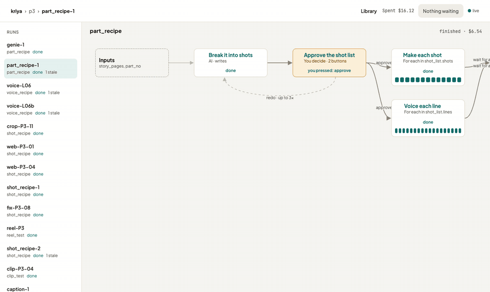

# kriya

**Run AI pipelines that stop for your judgement, then pick up exactly where they left off.**

kriya runs a recipe of steps (AI drafts, tools and your decisions) as a durable graph. Every step makes **versions**; you **lock** the one you want, and only locked work flows on. Change your mind upstream and kriya tells you what went **stale** and why, and redoes only that. A run can wait days for you, survive a crash, and never pay for the same call twice: everything is an append-only event log, replayed, never re-asked.



*The real Part 3 of* Mohalla Mitra *(an Instagram motion comic) in `kriya web`: 13 panels, 4 clips and 19 voice lines made end to end through kriya and assembled into a 106-second Reel.*

## Try it: three commands, no keys

```bash
git clone https://github.com/vinaypolisetty/kriya && cd kriya && pnpm install && export PATH="$PWD/bin:$PATH"
kriya init ~/kriya-demo --example mohalla-mitra && cd ~/kriya-demo
kriya run part_recipe --input part_no=1 --input story_pages="Mitra opens his chai stall; the water tank bursts" && kriya web
```

Open http://127.0.0.1:4317. The run is waiting for you to approve a shot list. Everything is fake (made-up text and placeholder images, $0) until you add keys. Node 20+ and pnpm 10+.

From the terminal instead: `kriya inbox` shows what's waiting, `kriya decide 1 approve` answers it, `kriya log part_recipe-1` tells you what happened. For real models, put `ANTHROPIC_API_KEY` / `REPLICATE_API_TOKEN` in the project's `.env` and set `models:` in `kriya.yaml` ([docs/cli.md](docs/cli.md)).

## What's in it

| | |
|---|---|
| **Recipes** in YAML | Steps (`model`, `agent`, `tool`, `screen` for your decisions, `map` for each item), arrows with conditions, loop limits. Mistakes come back in plain words with "did you mean" |
| **A durable engine** | Event log + replay, crash-safe calls with idempotency keys, for-each and joins, versions, locks, branches, stale tracking with reasons; rebuild, retry, adopt, keep |
| **Real providers** | Claude (writing, web research, judging, agents) and Replicate (images, clips, voices, music); exact model versions and costs recorded. Local ffmpeg tools, including a Reel assembler |
| **Checks and fixes** | A Claude judge per step; a fix loop that crops, edits or retries; a knowledge base that turns repeated failures into tips you can apply (`kriya tips`) |
| **The Library** | Characters, places and tracks with every version kept; a changed sheet makes the work that used it stale |
| **Two ways in** | The `kriya` CLI, and `kriya web`: the run as a graph you can rearrange, each step's versions and what happened, a review inbox that works on your phone over wifi |

Three examples ship with it: [`mohalla-mitra`](examples/mohalla-mitra) (story → shots → panels → clips → voices → Reel), [`earnings-report`](examples/earnings-report/README.md), a text-only one that finds each company's release on the web, summarizes it under a judge that holds it to the source, and ranks the quarter, and [`funny-clips`](examples/funny-clips/README.md), which finds the funny moments in a video you give it, writes the joke and cuts a caricature in.

**Status:** v0.1, finishing in November 2026. What's next: [docs/16-roadmap.md](docs/16-roadmap.md).

## For developers

```bash
pnpm test                # every package (no keys, no cost)
pnpm typecheck
pnpm validate:examples   # every recipe under examples/
pnpm check:conventions   # the repo's rules (CONTRIBUTING.md)
```

## What a recipe looks like

```yaml
graph: shot_recipe
level: shot
nodes:
  - id: draw
    kind: model
    capability: image.generate
    options: 3
    uses: [item.action, item.characters@look, item.place@look, series.style]
  - id: pick
    kind: screen
    review: pick_one
    show: draw.image
    actions:
      - { id: lock, needs: [selection] }
      - { id: edit, needs: [selection, note] }
      - { id: retry, needs: [note] }
  - id: edit
    kind: model
    capability: image.edit
    context: local
edges:
  - { from: draw, to: pick }
  - { from: pick, to: draw, when: "action == 'retry'", max_loops: 4 }
  - { from: pick, to: edit, when: "action == 'edit'" }
  - { from: edit, to: pick, max_loops: 4 }
  - { from: pick, to: END,  when: "action == 'lock'" }
```

The validator explains mistakes in plain words:

```
✗ shot.yaml:77:23  shot_recipe › edges[6].to
    'to' points at 'animat', which isn't a node. Did you mean 'animate'?
✗ shot.yaml:72:35  shot_recipe › edges[1].when
    screen 'pick' has no button 'retyr'. Did you mean 'retry'? (it has: lock, edit, crop, retry)
✗ shot.yaml:71:3   shot_recipe › edges
    loop draw → pick → draw has no limit; add max_loops to the edge that goes back
```

## Repository layout

```
packages/
  engine/            the recipe format, validation, and the deterministic core (events, state, scheduler)
  store/             the event log and Library history on SQLite; media by content hash
  adapters/          Claude, Replicate and ffmpeg tools as jobs; the fix policy
  cli/               projects on disk, the kriya commands, and the kriya web server
  web/               the browser app (React): run graph, inbox, review, Library
examples/
  mohalla-mitra/     part, shot and voice recipes for the reference use case
  earnings-report/   a text-only example: find each company's earnings release on the web, summarize, score, rank
  funny-clips/       a video in: Claude finds the funny moments, writes the joke, caricatures who's in it, cuts it in
docs/                design (01–19), architecture, CLI, decisions, roadmap, write-ups
scripts/             repo checks (conventions)
bin/kriya            runs the CLI from this checkout
```

## Documentation

**Writing your own recipe?** [docs/writing-recipes.md](docs/writing-recipes.md) builds one from nothing, step by step; [04-graph-spec](docs/04-graph-spec.md) is the field-by-field reference. Working in VS Code? [docs/getting-started-vscode.md](docs/getting-started-vscode.md).

**Changing the code?** Read [docs/architecture.md](docs/architecture.md) (how the packages fit, the life of a run, where to make a change) and [CONTRIBUTING.md](CONTRIBUTING.md) (conventions, tests, the review checklist). Each package has a README.

For the design, start with [docs/README.md](docs/README.md). The most important pages:

- [Vision](docs/01-vision.md): what this is and who it's for
- [Core concepts](docs/02-concepts.md): levels, nodes, versions, branches, locks, context, stale
- [Engine](docs/03-engine.md): how runs execute, suspend and resume
- [Graph spec](docs/04-graph-spec.md): the file format, field by field
- [Decisions](docs/17-decisions.md): what's been decided and why

## License

Apache-2.0. See [LICENSE](LICENSE).
